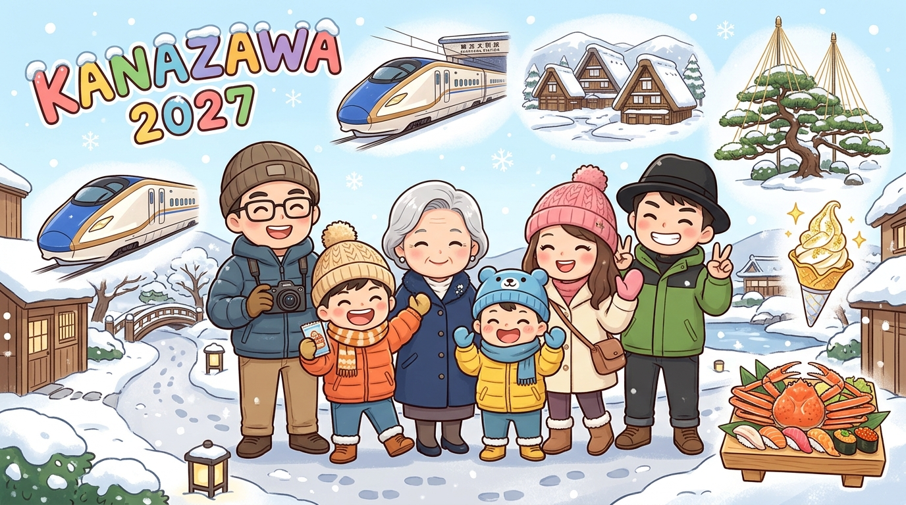

# 2027 金澤・合掌村・富山自由行規劃：6天5夜冬雪極致玩樂指南 (01/21 - 01/26) ➔ 【6人家族版：4大2小】

本規劃專為 **4 個大人、2 個小孩（共6人：張國展/郭展昌、老婆 顏佩如、媽媽 范淑慧、弟弟 郭展維、兩位小孩 郭品瑞 & 郭豐毅）** 量身打造，以 JR 金澤站西口（港口口）出站步行 1 分鐘的 **金澤凱悅尚萃酒店 (Hyatt Centric Kanazawa)** 作為全程 5 晚的住宿基地，免去冬天雪地拖行李換飯店的辛勞！

---

## 🚨 6人出行極重要憑證檢核與省錢交通攻略

### 1. ✈️ 長榮航空機票分成 3 組訂位代號 & 回程行李件數差異
* **去程**：2027/01/21 (四) 長榮航空 **BR158** ➔ `06:35` 桃園機場 T2 $\rightarrow$ `10:25` 小松空港 (KMQ)
  * *免費託運行李（H艙）*：**每人 2 件，每件 23 公斤**（全家人去程共可託運 12 件）。
* **回程**：2027/01/26 (二) 長榮航空 **BR157** ➔ `11:45` 小松空港 (KMQ) $\rightarrow$ `14:35` 桃園機場 T2
  * *免費託運行李（S艙）*：**⚠️ 每人僅限 1 件，每件 23 公斤**（全家人回程最多僅能託運 **6 件**！多帶的空箱或戰利品請改以手提登機箱/提袋上飛機）。
* **3 組長榮訂位代號（出發前 48 小時線上報到選位必備）**：
  1. **`FRW8TK`**：KUO/CHANCHANG MR、YEN/PEIJU MS、KUO/PINGJUI MSTR、KUO/FENGYI MSTR（2大2小）
  2. **`FYG5T4`**：FAN/SHUHUI MS（媽媽 范淑慧）
  3. **`BCMLAV`**：GUO/ZHANWEI MR（弟弟 郭展維）

### 2. 🏨 飯店兩張訂單資訊（金澤凱悅尚萃酒店 Hyatt Centric Kanazawa）
* **地址**：`〒920-0031 石川県金沢市広岡 1-5-2`（JR 金澤站西口／港口口出站左手邊步行 1 分鐘）
* **電話**：`+81-76-256-1360`
* **房間 1（易遊網 `ORD0030846987` / 飯店確認號 `1234223`）**：
  * **房型**：豪華特大床房（1張特大床，登記 3位成人 + 1位10歲孩童），**不含早餐**。
  * **付款狀態**：✅ **Paid 已付款**。
* **房間 2（易遊網 `ORD0030855929` / 飯店確認號 `46174665`）**：
  * **房型**：雙床房（2張單人床，登記 2位成人），**含 2 份早餐**。
  * **付款狀態**：✅ **Paid 已付款**。
* **⚠️ 現場費用提醒**：辦理入住時，飯店現場會另行收取 **金澤市住宿稅共約 TWD 1,200（兩間房合計，現場支付日圓現金或刷卡）**。

### 3. 🚌 大眾運輸省錢順路 4 大神技（公車＋新幹線＋利木津巴士）
1. **小松機場 ➔ 飯店直達：【小松機場利木津巴士】**
   * 班次完全配合飛機降落時間（領完行李走出國內線出口即上車），車程約 **40 分鐘**。
   * **神級優勢**：巴士終點站停在「**金澤站西口（港口口）**」，下車步行 1 分鐘就是你們住的 **Hyatt Centric 飯店大門**！
   * **車資**：單程大人 **¥1,300** / 孩童 **¥650**（可於售票機購票，或直接用 Visa / JCB 感應式信用卡上下車拍卡）。
2. **金澤市區神卡：【城下町金澤周遊巴士一日券】（大人 ¥800 / 孩童 ¥400）**
   * 金澤周遊巴士單趟大人 **¥210**（孩童 ¥110），只要一天搭 **4 趟以上** 就回本，出示一日券買 **兼六園、金澤城** 門票再享團體折扣！
   * **數位購買最方便**：手機開啟 **「のりまっし金沢 (Norimasshi Kanazawa)」** 網頁/App，一支手機可同時購買全家人的數位一日券，下車出示手機畫面即可。
   * **⚠️ 注意**：金澤巴士**不支援西瓜卡 (Suica / ICOCA)**，但支援 **感應式信用卡（Visa/Master/JCB）直接上下車逼卡**。因此 **Day 1 只搭 2~3 趟時直接刷信用卡最省；Day 4、Day 5 搭 4~5 趟時買 ¥800 一日券最划算！**
3. **Day 3 富山一日遊：【單買北陸新幹線自由席 ＋ 富山路面電車】**
   * **千萬別買 JR 北陸周遊券（¥7,000）**！因為你們 Day 2 是包車去合掌村，實際只搭 Day 3 富山來回，單買北陸新幹線自由席（金澤 $\leftrightarrow$ 富山，車程僅 **20 分鐘**，單程大人 **¥2,860** / 來回 **¥5,720**，孩童半價）現省 ¥1,280！
   * **富山路面電車（市電）**：單趟大人 **¥210** / 孩童 **¥110**（**支援 Suica / ICOCA 西瓜卡與信用卡感應**）。

---

## 🗓️ 六天五夜詳細行程規劃

### Day 1 ｜ 01/21 (週四) 抵達小松・近江町市場松葉蟹大餐 & 東茶屋街金箔霜淇淋
> 💡 *今日交通策略：機場利木津巴士（¥1,300）＋ 市區公車單趟刷信用卡感應 3 趟（¥630），免買一日券最省！*
* **上午（10:25 - 12:15）：【抵達小松機場 & 搭乘利木津巴士直達金澤站西口】**
  * 長榮 BR158 抵達小松空港，出關後於國內線 1 號乘車處搭乘「小松空港リムジンバス」，約 40 分鐘直達金澤站西口。步行 1 分鐘至 **Hyatt Centric Kanazawa** 寄放行李。
* **中午（12:30 - 14:30）：【近江町市場（金澤的廚房）】**
  * *Google Map 搜尋：* `近江町市場` / `山さん寿司 本店` / `いきいき亭 近江町店`
  * *公車路線：* 從金澤站東口 **7號乘車處** 搭城下町周遊巴士（右迴 RL 或左迴 LL 皆可）約 **5 分鐘** 至「武藏ヶ辻・近江町市場」下車。
  * *必吃重點：* 全室內有遮雨棚不怕下雪！1月正是冬季限定 **「加能蟹（松葉蟹）」、「甜蝦」、「寒鰤魚」** 最肥美的季節，推薦吃豪華海鮮丼、現烤大扇貝與海膽。
* **下午（15:00 - 17:30）：【東茶屋街（ひがし茶屋街）＆ 箔一金箔霜淇淋】**
  * *Google Map 搜尋：* `ひがし茶屋街` / `箔一 東山店`
  * *公車路線：* 從近江町市場搭周遊巴士「右迴線 RL」約 **5 分鐘** 至「橋場町」站下車步行 5 分鐘。
  * *必玩重點：* 江戶時代完整保留的木造茶屋老街，雪景下極具古都韻味。必吃 **【箔一 東山店】整片24K食用金箔霜淇淋**，也可帶媽媽與小孩在室內體驗金箔貼畫 DIY 或去「懷華樓」喝金箔紅豆湯暖身。
* **晚上（18:00 - 20:30）：【金澤站 鼓門夜景 & 百番街 / Cross Gate 晚餐】**
  * *Google Map 搜尋：* `金沢駅 鼓門` / `クロスゲート金沢` / `黒百合`
  * *公車路線：* 從「橋場町」搭公車返回金澤站（約 10 分鐘）。
  * *必吃重點：* 欣賞世界最美車站之一的「鼓門」夜間點燈，晚餐在金澤站百番街「あんと (Anto)」享用老字號 **【黑百合 (黒百合)】金澤關東煮**，或在飯店隔壁棟的 **【Cross Gate 金澤】** 2樓美食街吃能登牛料理。

---

### Day 2 ｜ 01/22 (週五) ❄️ 專車包車一日遊：白川鄉合掌村童話雪景 & 飛驒高山老街
> 💡 *今日交通策略：已預訂專屬包車（08:30 飯店大門口上下車），全家人免吹冷風、車上隨時放外套與戰利品！*
* **上午（08:30 - 10:00）：【金澤凱悅尚萃飯店出發 ➔ 白川鄉城山天守閣展望台】**
  * *Google Map 搜尋：* `城山天守閣 展望台`
  * *導遊私房貼心安排：* 自由行散客去展望台要排隊搭接駁車或爬坡，**你們有包車，直接請司機先載全家人開上「城山展望台」**！長輩小孩完全免爬坡，就能俯瞰整座被白雪覆蓋的合掌村童話全景！
* **中午（10:30 - 13:30）：【白川鄉荻町合掌村漫步 & 朴葉味噌飛驒牛午餐】**
  * *Google Map 搜尋：* `白川郷` / `和田家` / `いろり (Irori)`
  * *必玩重點：* 參觀重要文化財「和田家」內部閣樓結構、漫步相逢橋（であい橋），午餐在合掌造古民家餐廳（如 `いろり` 或 `白水園`）圍著地爐享用熱騰騰的 **飛驒牛朴葉味噌燒定食**。
* **下午（14:30 - 16:45）：【飛驒高山老街（上三之町）或 五箇山菅沼合掌村】**
  * *Google Map 搜尋：* `飛騨高山 古い町並 (上三之町)` / `こって牛`
  * *必吃重點：* 漫步高山古街，必排 **【飛驒こって牛】放在竹炭仙貝上的 A5 飛驒牛三貫握壽司**、飛驒牛包子，大人還可以逛百年味噌老舖與清酒造試飲。
* **晚上（18:30 - 20:30）：【返回金澤 ➔ 晚餐：もりもり寿し (Mori Mori 壽司) 金澤Forus店】**
  * *Google Map 搜尋：* `もりもり寿し 金沢フォーラス店`
  * *排隊攻略：* 位於金澤站東口 Forus 百貨 6 樓。建議包車抵達後先去店門口抽發券機號碼牌，等待期間可在 Forus 百貨內逛街，必點「北陸五貫盛合（含紅喉魚、白蝦、甜蝦）」。

---

### Day 3 ｜ 01/23 (六) 🚄 北陸新幹線・富山一日遊：世界最美星巴克、冰見寒鰤魚 & 玻璃美術館（晴天加選：雨晴海岸）
> 💡 *今日交通策略：北陸新幹線自由席＋JR城端線＋JR冰見線＋愛之風富山鐵道＋富山路面電車。全程搭乘大眾鐵道運輸，零計程車開銷，極致省錢順暢！*

#### 🌊 【導遊專屬分析】：富山加排「雨晴海岸（女岩・雪白立山連峰）」會推薦嗎？
* **導遊總結結論**：**「非常推薦，但強烈建議列為【當日晴天限定的彈性加選方案】，千萬不要當成死板的硬性主行程！」**
* **即時 WebCam 監測（出發前點擊一秒看現場）**：
  * 🔴 **[道の駅 雨晴 YouTube 官方 24 小時高畫質直播](https://www.youtube.com/@%E9%81%93%E3%81%AE%E9%A7%85%E9%9B%A8%E6%99%B4/live)**（直面女岩與富山灣，畫面有雪白立山連峰立刻衝！）
  * 🌐 **[道の駅 雨晴 官方網站即時情報](https://michinoeki-amaharashi.jp/)**（含現場停車場與天候狀態）
  * 🏔️ **[富山市役所 官方立山連峰即時 LiveCam](https://www.city.toyama.lg.jp/shisei/profile/1010702/1013545/index.html)**（富山市區遠眺立山全景觀測點）
* **關鍵決策法則（當天早晨看天氣決定）**：
  1. ☀️ **若 01/23 當日清晨是萬里無雲的「超級大晴天」**：**100% 值得衝！** 冬天積雪的 3,000 公尺立山連峰倒映在富山灣海面與女岩背後，是名列日本一生必看的世界級絕景！
  2. ☁️ **若 01/23 當日是「陰天、多雲、飄雪或下雨」**：**絕對不要去！** 北陸 1 月冬天天氣陰雨多雲機率高達 80% 以上，歷史統計 1 月能清楚看見雪山的天數僅 4～8 天。如果沒有大晴天，現場只是一片灰濛濛的海洋與礁石，海邊寒風極為刺骨，帶著媽媽（長輩）和兩個小孩吹風容易著涼。陰天直接維持原訂「富山市區星巴克＋玻璃美術館＋室內壽司百貨」的暖心路線最舒適！
* **晴天時的 6 人純火車大眾運輸省錢走法（不搭計程車、順時針不走回頭路）**：
  * **09:00 - 11:30**：
    1. 金澤站搭北陸新幹線僅 **14 分鐘** 抵達「新高岡站」，同站轉乘 JR 城端線（3 分鐘）抵達「高岡站」。
    2. 高岡站轉乘 **【JR 冰見線】**（約 21 分鐘，單程大人僅 **¥240** / 孩童 **¥120**，超便宜省錢！）直接坐到 **「雨晴站」**。
    3. **出站步行 3 分鐘** 即達 **【道の駅 雨晴（公路休息站）】**。
  * **【道の駅 雨晴】神級室內暖氣優點**：2018 年新落成的全白現代建築，2F/3F 設有整面大落地窗的「室內暖氣景觀咖啡廳」！全家人可以在室內吹著舒服暖氣、喝熱可可與咖啡，悠閒眺望海面女岩與背後壯麗的立山連峰雪山，還能看到冰見線彩繪列車開過海岸！想拍照再走出去觀景台拍 3 分鐘即可，長輩與小孩完全不用吹冷風。
  * **11:30 - 12:15**：在室內看好冰見線回程時刻表，提前 5 分鐘走回雨晴站搭車返回高岡站，接著轉乘「愛之風富山鐵道（約 18 分鐘，¥390）」無縫抵達富山站吃午餐！全程均為大眾運輸，免花任何計程車錢！

---

* **上午方案 A（晴天模式 09:00 - 12:00）：【金澤 ➔ 新高岡 ➔ 雨晴海岸（道の駅 雨晴 看雪白立山連峰）➔ 富山】**
* **上午方案 B（一般/陰天模式 09:20 - 12:00）：【金澤 ➔ 富山站 ➔ 富岩運河環水公園 & 世界最美星巴克】**
  * *Google Map 搜尋：* `富岩運河環水公園` / `スターバックス コーヒー 富山環水公園店`
  * *交通路線：* 從富山站「北口」沿著平坦寬敞的景觀大道步行約 **9 分鐘** 即達（若下大雪亦可於北口搭巴士）。
  * *必玩重點：* 被譽為「世界最美星巴克」的玻璃木造建築，被銀白雪景、運河與天門橋包圍，遠方亦能眺望立山連峰雪山！天門橋兩端塔樓頂層還有免費的「命運紅線電話筒」可讓小孩互動。
* **中午（12:15 - 13:45）：【午餐：廻る富山湾 すし玉 (壽司玉) 或 白蝦亭 (しろえび亭)】**
  * *Google Map 搜尋：* `廻る富山湾 すし玉 富山駅店` / `白えび亭`
  * *必吃重點：* 就在富山站 1 樓「きときと市場 とやマルシェ」內！1月來富山絕對不能錯過冬季王者 **「冰見寒鰤魚（ひみ寒ぶり）」** 與被稱為「富山灣寶石」的 **「白蝦天婦羅丼 / 白蝦刺身丼」**！
* **下午（14:00 - 16:30）：【富山市玻璃美術館 (TOYAMA KIRARI) & 池田屋安兵衛商店】**
  * *Google Map 搜尋：* `富山市ガラス美術館` / `池田屋安兵衛商店`
  * *路面電車路線：* 在富山站大廳內直接搭「富山地方鐵道市電（往南富山駅前方向，3號系統或環狀線）」至 **「西町（Nishicho）」** 下車即達（車程約 12 分鐘，單趟 ¥210）。
  * *必玩重點：*
    1. **富山市玻璃美術館**：建築大師隈研吾設計，內部以大量雪松木百葉窗與玻璃交織，像極了溫暖的冰雪森林，6 樓「Glass Art Garden」展出奇胡利（Dale Chihuly）的大型繽紛玻璃藝術。
    2. **池田屋安兵衛商店**（玻璃美術館步行 3 分鐘）：富山三百年漢方藥老舖，店員會現場免費讓大家體驗用傳統木製模具「手推越中反魂丹藥丸」，長輩與小孩玩得超開心！
* **傍晚（16:45 - 18:30）：【富山站 MAROOT 百貨逛街 ➔ 搭北陸新幹線返金澤】**
  * 從「西町」搭路面電車返回富山站，逛逛全新的 **MAROOT 百貨** 與買ますのすし（源 鱒魚押壽司）伴手禮，搭新幹線 20 分鐘回金澤。
* **晚上（19:00 - 20:30）：【晚餐：金澤 おでん 赤玉本店 或 金澤百番街名店】**
  * 品嚐金澤冬季暖胃湯料理，回飯店休息。

---

### Day 4 ｜ 01/24 (日) 🚌 周遊巴士一日券：兼六園冬季雪吊、金澤城、21世紀美術館 & 武家屋敷
> 💡 *今日交通策略：全員啟用 **【城下町金澤周遊巴士一日券（大人 ¥800 / 孩童 ¥400）】**，今日搭 4~5 趟完全回本，兼六園門票出示一日券再享團體價（¥320 ➔ ¥250）！*
* **上午（09:15 - 11:45）：【日本三大名園之首：兼六園（冬季雪吊）& 金澤城公園】**
  * *Google Map 搜尋：* `兼六園` / `金沢城公園` / `時雨亭`
  * *公車路線：* 金澤站東口 **7號乘車處** 搭乘周遊巴士「右迴線 RL」或「左迴線 LL」至 **「兼六園下・金澤城（RL8 / LL9）」** 下車。
  * *導遊不鐵腿走法：* 兼六園在斜坡上，**帶媽媽跟小孩請走坡度最平緩的「桂坂口」或「蓮池門口」進園**！必看冬季限定的圓錐形繩索奇景 **「唐崎松雪吊（雪吊り）」** 與霞之池「徽軫燈籠」。逛累了強烈推薦進園內的 **【時雨亭】**（室內塌塌米有暖氣），每人花 ¥700 喝現刷抹茶配金澤生菓子看雪景庭園！
* **中午（12:00 - 13:30）：【午餐：自由軒 懷舊蛋包飯 或 兼六園茶屋街美食】**
  * *Google Map 搜尋：* `レストラン自由軒` / `見城亭`
  * *必吃重點：* 百年洋食老店「自由軒」的招牌醬油風味蛋包飯配炸豬排，大人小孩都超愛。
* **下午（13:45 - 15:45）：【金澤 21 世紀美術館 & 石川縣立美術館（LE MUSEE DE H 甜點）】**
  * *Google Map 搜尋：* `金沢21世紀美術館` / `ル ミュゼ ドゥ アッシュ KANAZAWA`
  * *交通路線：* 從兼六園「真弓坂口」過馬路即達 21 世紀美術館（公車站：廣坂・21世紀美術館）。
  * *必玩重點：* 參觀世界知名的《泳池 (The Swimming Pool)》互動藝術（人在水底下往上看的奇幻視角，*註：地下泳池區需於當日早上 09:00 透過官方網站進行線上抽選/預約時段*）。隨後可到隔壁石川縣立美術館內的 **【LE MUSEE DE H】** 享用日本甜點冠軍辻口博啟的精緻蛋糕配大片落地窗雪景。
* **下午（16:00 - 18:00）：【長町武家屋敷跡（冬季限定稻草牆）& 香林坊大和百貨商圈】**
  * *Google Map 搜尋：* `長町武家屋敷跡` / `野村家` / `香林坊大和`
  * *公車路線：* 搭周遊巴士 1 站至 **「香林坊（RL10 / LL8）」** 下車步行 4 分鐘。
  * *必玩重點：* 冬季限定的「薦掛け（Komogake）」——為了防止積雪凍裂土牆，整條武家屋敷街道的土牆都會披上金黃色的稻草簾，非常有北陸冬日風情！參觀米其林二星庭園「武家屋敷跡 野村家」，接著在香林坊商圈採買藥妝。
* **晚上（18:15 - 20:15）：【晚餐：金澤溫野菜 / 壽喜燒 或 居酒屋美食 ➔ 搭周遊巴士回金澤站】**
  * 從「香林坊」搭周遊巴士直達金澤站（約 10 分鐘）。

---

### Day 5 ｜ 01/25 (週一) 🥷 忍者寺機關大探秘、西茶屋街、哈頓飯 & 金澤站最後大採買
> 💡 *今日交通策略：全員啟用第 2 張 **【城下町金澤周遊巴士一日券（大人 ¥800 / 孩童 ¥400）】**，走「左迴線 LL」最順路！*
* **上午（09:45 - 11:30）：【妙立寺（忍者寺）機關探秘 & 西茶屋街】**
  * *Google Map 搜尋：* `妙立寺 (忍者寺)` / `にし茶屋街`
  * *公車路線：* 金澤站東口 **7號乘車處** 搭乘周遊巴士 **「左迴線 LL」** 約 14 分鐘至 **「廣小路（LL6）」** 下車，步行 4 分鐘即達。
  * *必玩重點（親子第一名推薦！）：* 雖然叫忍者寺但其實是前田藩主的秘密軍事據點！外觀看是 2 層樓，裡面卻有 **4 層樓 7 層結構、23 個房間與 29 座樓梯**，包含翻轉暗門、陷阱地洞、逃生井等超酷機關（全室內專人導覽，提供中文詳細導覽手冊）。
  * *⚠️ 預約提醒：* 妙立寺 **必須電話預約**，建議 Day 1 入住 Hyatt Centric 時，直接請飯店櫃檯人員幫忙打電話（`076-241-0888`）預約 Day 5 上午 10:00 或 10:30 的 6 人場次！
  * 參觀完步行 3 分鐘順遊 **【西茶屋街】**，去「甘納豆かわむら」買超人氣手工甘納豆伴手禮。
* **中午（11:45 - 13:15）：【午餐：グリルオーツカ (Grill Otsuka) 必吃哈頓飯】**
  * *Google Map 搜尋：* `グリルオーツカ`
  * *公車路線：* 從「廣小路」搭周遊巴士「左迴線 LL」約 4 分鐘至「香林坊」下車步行 5 分鐘。
  * *必吃重點：* 金澤靈魂B級美食 **「哈頓飯 (ハントンライス Hanton Rice)」**——滑嫩半熟蛋包飯上鋪滿現炸酥脆白身魚與鮮蝦，淋上特製番茄醬與濃郁塔塔醬，兩個小孩絕對秒殺！
* **下午（13:30 - 17:30）：【金澤站 Rinto / Anto 百番街 & Forus 百貨 伴手禮藥妝總採購】**
  * *Google Map 搜尋：* `金沢百番街 Rinto` / `金沢百番街 あんと` / `金沢フォーラス`
  * *公車路線：* 搭周遊巴士返回「金澤站」。
  * *採買攻略：*
    * **あんと (Anto)**：買金澤限定伴手禮（烏雞庵金箔蜂蜜蛋糕、加賀棒茶、北陸限定白蝦仙貝、中田屋鍔餅、金箔化妝水）。
    * **Rinto & Forus**：Uniqlo、GU、Pokemon Center Kanazawa（**金澤寶可夢中心在 Forus 5樓，有穿日式和服的限定版皮卡丘，小孩必去！**）、大國藥妝與電器。
    * 買完直接走回西口 Hyatt Centric 飯店房間打包行李（記得整理成 **6 個託運行李箱**）！
* **晚上（18:00 - 20:30）：【慶功晚宴：能登牛燒肉 肉匠Jade金澤 (にくしょう ジェイド)】**
  * *Google Map 搜尋：* `肉匠Jade金澤` (地址：石川県金沢市本町 2-15-1 ポルテ金沢 B1F，金澤站東口對面步行 2 分鐘)
  * *必吃重點：* 農林水產大臣賞認證的夢幻 **「A5 能登牛」** 專賣店，有舒適包廂座位，全家人一起大啖入口即化的頂級能登牛燒肉慶祝完美旅程！

---

### Day 6 ｜ 01/26 (週二) 🚌 利木津巴士直達小松機場・免稅採購 & 平安返台
> 💡 *今日交通策略：飯店旁金澤站西口巴士站搭乘【小松機場利木津巴士（大人 ¥1,300 / 孩童 ¥650）】直達機場。*
* **08:00 - 08:30**：於 **Hyatt Centric Kanazawa** 辦理退房，拉行李步行 1 分鐘至「金澤站西口 3 號乘車處」。
* **08:40 - 09:20**：搭乘配合長榮 BR157 航班的 **【小松機場利木津巴士】**（車程約 40 分鐘，直達小松機場航廈門口）。
* **09:20 - 11:15**：辦理長榮航空 BR157 報到託運（**再次確認：6人共限託運 6 件各 23kg 行李**）。通關前可先在 1F/2F「空の駅こまつ」與 3F 景觀台逛逛，入關後於免稅店補齊 ROYCE 生巧克力、白色戀人與清酒。
* **11:45 - 14:35**：搭乘 **長榮航空 BR157** 起飛，於台灣時間 14:35 平安降落桃園國際機場第二航廈！

---

## ☔ 冬季大雪 / 雨天備案與行程調整計畫

北陸 1 月常有降雪或「雪雨（みぞれ）」，鞋襪容易濕冷，若遇暴風雪或大雨，請立即切換以下室內備案：
1. **必備防雪穿搭**：全家人（特別是媽媽范淑慧與兩個小孩）務必穿 **「防水防滑底雪靴 / Gore-Tex 防水鞋」**（千萬別穿一般布面運動鞋，踩雪融化會全濕冰冷），並可於金澤超商或藥妝店購買「鞋底防滑冰爪套」與足貼暖暖包。
2. **各日室內替代方案**：
   * **Day 1（東茶屋街風雪過大）** ➔ 改去全室內的 **【箔一 箔巧館（金箔博物館）】** 或金澤站 **【金澤百番街 / Forus 百貨】**。
   * **Day 2（白川鄉因暴雪封路）** ➔ 包車直接改往南走 **【加賀傳統工藝村 湯之國之森（ゆのくにの森）】**（多棟室內傳統工藝館，可體驗彩繪九谷燒、貼金箔、做蕎麥麵）與 **【那谷寺】**。
   * **Day 3（富山環水公園風雪過大）** ➔ 縮短戶外停留，直接搭路面電車進入全室內的 **【富山市玻璃美術館】** 與富山站共構的 **【MAROOT 百貨 / マリエとやま】**。
   * **Day 4（兼六園下大雪太冷）** ➔ 拍完雪吊後立刻進入園內 **【時雨亭】** 吹暖氣喝抹茶，隨後轉往全室內的 **【金澤 21 世紀美術館】** 與 **【石川縣立美術館（LE MUSEE DE H 甜點店）】**。
   * **Day 5（西茶屋街戶外太冷）** ➔ **【妙立寺（忍者寺）】** 本身就是全室內景點，結束後直接回 **【金澤 Forus 5樓 寶可夢中心 & 百番街】** 室內逛街。
